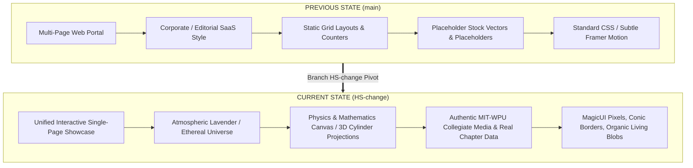
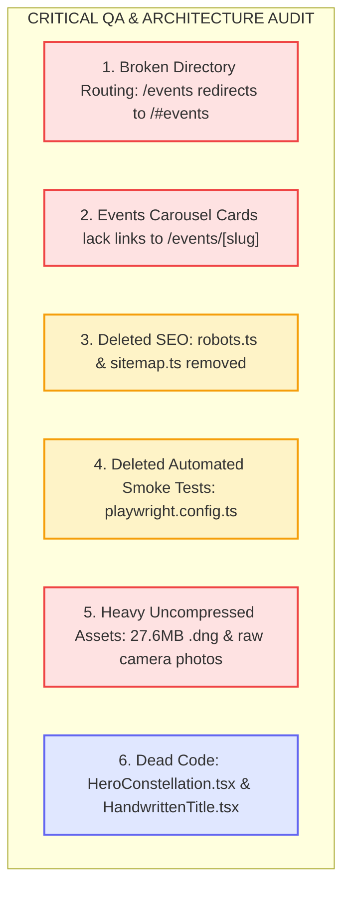

# SWE MIT-WPU Chapter Website — Comprehensive Architecture & Evolution Analysis

**Document Type:** Senior Architectural Review & Codebase Comparative Analysis  
**Branch Evaluated:** `HS-change` (incorporating commits `376d1a7`, `74d3289`, and `5c68dde`)  
**Base Reference:** `main` branch (Phase 0–5 initial scaffold)  
**Target:** Society of Women Engineers (SWE), MIT-WPU Student Chapter, Pune, India  

---

## 1. Executive Summary & Paradigm Shift

The codebase has undergone a fundamental architectural and aesthetic pivot across the last three commits on `HS-change`.



| Dimension | Previous State (`main`) | Current State (`HS-change`) |
|---|---|---|
| **Architecture** | Traditional multi-route portal (`/`, `/events`, `/team`, `/gallery`, `/contact`, `/impact`) | Single-page narrative flow with persistent ambient canvas and anchor scroll-spy navigation (`#hero`, `#about`, `#events`, `#team`, `#impact`, `#gallery`, `#contact`) |
| **Visual Tone** | Minimalist corporate tech (#FAFAF9 warm off-white, sharp borders, static cards) | Ethereal editorial & motion universe (living ambient mesh gradient blobs, serif display accents) |
| **Hero Experience** | Standard heading, static subtitle, placeholder buttons | Interactive canvas constellation with 10 historic STEM pioneer nodes reacting to cursor repulsion + live typewriter effect |
| **Team Directory** | Standard 2D card grid on a separate `/team` route with placeholder avatars | Two interactive 3D perspective cylindrical carousels (**Core Team** & **The Heads**) with pan momentum and genuine student headshots |
| **Events Experience** | Static cards with hard dates, categories, and tags linking to `/events/[slug]` | Physics-based horizontal glide carousel with spring kinetics, notion-style banner headers, and gap ticks |
| **Impact Experience** | Recharts bar/metric counters (*"Impact by Numbers"*) | *"Stories That Stay"* alumnae testimonials featuring continuously rotating conic gradient borders and mouse spotlights |
| **Gallery Experience** | 6 static SVG placeholder cards | Dynamic React Bits Masonry grid with 18 authentic chapter photos and interactive full-screen lightbox |
| **Contact Experience** | Basic contact form on a dedicated `/contact` route | Live real-time IST chapter desk open/closed status calculator, one-click address copy, and direct department dispatch |
| **Data Authenticity** | All names, photos, and metrics marked as `__PLACEHOLDER__` | Genuine MIT-WPU student leaders, genuine chapter milestones (2025–2026), and authentic campus photography |

---

## 2. Section-by-Section Deep Dive: "Before" vs. "After"

### 2.1 Global Canvas, Ambience & Typography

#### Before (`main`):
- Background was static off-white (`--background: #FAFAF9`), foreground dark charcoal (`#1A1A1A`), with static 1px borders (`#E5E5E3`).
- Typography was strictly **Space Grotesk** for headings and **Inter** for body text.

#### Now (`HS-change`):
- Global layout wrapped in [`BlobBackground.tsx`](file:///c:/Users/DELL/OneDrive/Desktop/SWE_website/components/BlobBackground.tsx) and [`BlobBackground.css`](file:///c:/Users/DELL/OneDrive/Desktop/SWE_website/components/BlobBackground.css).
- Four organic radial blur mesh gradients (`radial-gradient`) continuously orbit and glide across key sections via hardware-accelerated CSS keyframes (`aboutBlobOrbit`, `aboutBlobGlide`).
- Replaced display typography with **`Instrument_Serif` (italic)** as `--font-accent` across display titles (*"Society of Women Engineers"*, *"Moments in Motion"*, *"Stories That Stay"*), maintaining high editorial elegance.

---

### 2.2 Hero Section

#### Before (`main`):
- Text-heavy static layout with standard H1, subtext, and two buttons (*"Explore Initiatives"*, *"Join SWE MIT-WPU"*).
- Background was an empty container intended for a future Three.js model.

#### In Commit `74d3289` (Intermediate Stage):
- Supplied purple-pink grainy gradient (`hero-bg-gradient.jpg`) with a cursor spotlight mask revealing a vintage sepia collage of women in STEM.
- Centerpiece handwritten logo split into two levitating PNG layers with replay capability.

#### Now in Commit `5c68dde` ([`Hero.tsx`](file:///c:/Users/DELL/OneDrive/Desktop/SWE_website/components/sections/Hero.tsx) + [`HeroConstellation.css`](file:///c:/Users/DELL/OneDrive/Desktop/SWE_website/components/sections/HeroConstellation.css)):
- **Interactive Constellation Canvas:** High-DPI `<canvas>` tracking 10 historic women in STEM:
  * *Ada Lovelace* (Algorithms), *Marie Curie* (Radioactivity), *Grace Hopper* (Compiler), *Katherine Johnson* (Trajectories), *Hedy Lamarr* (Wireless), *Margaret Hamilton* (Apollo), *Radia Perlman* (Networking), *Kalpana Chawla* (Astronaut), *Tessy Thomas* (Missiles), *Anandi Gopal Joshi* (Medicine).
- **Physics Repulsion:** Nodes maintain harmonic floating trajectories (`Math.sin(t/2400 + ph)`) but repel from the cursor when within 170px ($k = (1 - d/170) \cdot 10 / d$).
- **Dynamic Connections:** Inter-node lines rendered dynamically whenever Euclidean distance $< L$ with opacity proportional to proximity:
  $$\text{opacity} = \left(1 - \frac{d}{L}\right) \cdot 0.22$$
- **Live Typewriter Header:** Cycles continuously through chapter core tenets (*collaborate, network, learn, grow, lead, innovate, inspire*).

---

### 2.3 About Us Section

#### Before (`main`):
- Left column text with bulleted metrics.
- Right column had a 4.7MB portrait of Treasurer Ananya Deshmukh mistakenly assigned with alt text for the whole chapter.

#### Now (`HS-change` in [`About.tsx`](file:///c:/Users/DELL/OneDrive/Desktop/SWE_website/components/sections/About.tsx)):
- **Atmospheric Background Blobs:** Orbital lavender gradients floating behind the copy.
- **MagicUI Pixel Reveal ([`pixel-image.tsx`](file:///c:/Users/DELL/OneDrive/Desktop/SWE_website/registry/magicui/pixel-image.tsx)):** Replaced the single portrait with the genuine SWE engineering expo photograph ([`swe-expo.png`](file:///c:/Users/DELL/OneDrive/Desktop/SWE_website/public/images/about/swe-expo.png)).
- Hovering over the image activates a $4 \times 6$ grid pixelation transition from grayscale to vibrant color.
- Copy rewritten to highlight collegiate community values, gender inclusivity, and MIT-WPU campus roots.

---

### 2.4 Events & Initiatives Section

#### Before (`main`):
- Dedicated directory page with category filtering (Hackathons, Workshops, Outreach, Talks).
- Grid of static cards linking to detailed markdown pages (`/events/[slug]`).

#### Now (`HS-change` in [`EventsCarousel.tsx`](file:///c:/Users/DELL/OneDrive/Desktop/SWE_website/components/sections/EventsCarousel.tsx)):
- **Physics Gliding Carousel:** Smooth horizontal card navigation driven by Framer Motion motion values.
- **Card Scaling & Veiling:**
  $$\text{scale} = 1 - 0.22 \cdot \min(|o|, 1)$$
  Neighbouring cards softly dim via dynamic veil opacity (`SIDE_DIM * min(|offset|, 1)`).
- **Kinetic Flick Momentum:** Drag interactions support momentum gestures (`FLICK_MOMENTUM = 0.32`, spring stiffness 130, damping 25).
- **Gap Ticks:** Custom vertical tick marks placed between cards that animate spacing dynamically during drag gestures.
- **Real Timeline Data ([`timelineEvents.ts`](file:///c:/Users/DELL/OneDrive/Desktop/SWE_website/content/timelineEvents.ts)):** Real milestones from 2025–2026 (*Ice Breaker Ceremony*, *ResQ Animal Shelter Outreach*, *WeLocal Bengaluru*, *Jab SWE Met Hackathon*, *Orientation 2026*).

---

### 2.5 Team Showcase: 3D Cylindrical Projection

#### Before (`main`):
- Generic 3-column static grid on `/team` with placeholder names and unsplash images.

#### Now (`HS-change` in [`TeamSection.tsx`](file:///c:/Users/DELL/OneDrive/Desktop/SWE_website/components/sections/TeamSection.tsx) & [`CylindricalTeamCarousel.tsx`](file:///c:/Users/DELL/OneDrive/Desktop/SWE_website/components/team/CylindricalTeamCarousel.tsx)):
- **Mathematical 3D Cylindrical Geometry:**
  Cards are arranged around a virtual cylinder in 3D perspective space:
  $$\text{radius} = \frac{\text{cardWidth} + \text{gap}}{2 \cdot \sin(\pi / N)}$$
  $$\text{transform} = \text{rotateY}(i \cdot \theta)\; \text{translateZ}(\text{radius})$$
- **Dual Tiers:**
  1. **Core Team (8 Faces, $\theta = 45^\circ$):** President Aarika Shah, VP Padmali Joshi, Secretary Dia Swami, Joint Secretary Fariha Naikwadi, Treasurer Ananya Deshmukh, Joint Treasurer Rashi Rangrej, Affiliate Manager Mrinmayee Gokhale, Joint Affiliate Manager Krisha Oswal.
  2. **The Heads (14 Faces, $\theta = 25.7^\circ$):** All 14 committee directors (Sponsorship, HR, Content, Events, Media & Marketing, Design, Technical).
- **Interactive Drag & Momentum:** Panning horizontally rotates the cylinder with degrees converted from touch delta ($\text{deg} = \text{px} \cdot \frac{360}{2\pi \cdot \text{radius}}$), accompanied by spring inertia and active card tracking (`01 / 08`, `01 / 14`).

---

### 2.6 Impact Section: "Stories That Stay"

#### Before (`main`):
- Static numeric statistics counter grid (e.g. 500+ Members, 24+ Workshops).

#### Now (`HS-change` in [`ImpactPreview.tsx`](file:///c:/Users/DELL/OneDrive/Desktop/SWE_website/components/sections/ImpactPreview.tsx)):
- Replaced with **Alumnae Testimonials** ([`alumniStories.ts`](file:///c:/Users/DELL/OneDrive/Desktop/SWE_website/content/alumniStories.ts)).
- **Rotating Conic Gradient Border:** Each card has an outer border running a continuous CSS conic rotation between SWE purple and gold:
  ```css
  conic-gradient(from 0deg, #6538A5 0deg, #A78BDA 75deg, #F5D76E 150deg, #E8B94F 210deg, #A78BDA 285deg, #6538A5 360deg)
  ```
- **Mouse-Following Spotlight:** Inner spotlight (`radial-gradient`) tracking mouse coordinates across the card surface on hover.

---

### 2.7 Photo Gallery: React Bits Masonry & Lightbox

#### Before (`main`):
- 6 static SVG illustrations with placeholder captions.

#### Now (`HS-change` in [`GallerySection.tsx`](file:///c:/Users/DELL/OneDrive/Desktop/SWE_website/components/sections/GallerySection.tsx) & [`Masonry.jsx`](file:///c:/Users/DELL/OneDrive/Desktop/SWE_website/components/Masonry.jsx)):
- **Masonry Grid Engine:** True Pinterest-style cascading masonry layout calculating column heights dynamically with stagger animations.
- **18 Authentic Chapter Photographs:** High-resolution campus captures from hackathons, workshops, and community drives.
- **Full-Screen Lightbox Portal:** Clicking any photo opens an animated backdrop modal with zoom, image captions, and arrow navigation.

---

### 2.8 Contact Section & Chapter Status

#### Before (`main`):
- Standalone `/contact` route with standard form inputs.

#### Now (`HS-change` in [`ContactExact.tsx`](file:///c:/Users/DELL/OneDrive/Desktop/SWE_website/components/contact/ContactExact.tsx)):
- Directly embedded on the homepage landing flow.
- **Live IST Business Hours Engine:** Queries Indian Standard Time (`Asia/Kolkata`) in real time. If the current time is between Mon–Fri 10:00 AM – 5:30 PM IST, it shows:
  > 🟢 **Chapter desk is open now · until 5:30 PM IST**  
  Otherwise, it dynamically toggles to:
  > ⚪ **Chapter desk is closed · opens Mon–Fri, 10:00 AM IST**
- One-click copy for the campus physical address with instant confirmation feedback.

---

## 3. QA Audit & Engineering Debt Analysis

While the design elevation is remarkable, several technical debts and regressions must be tracked:



### Specific QA Issues to Fix:

1. **Events Carousel Missing Detail Links:**  
   Clicking an event card in [`EventsCarousel.tsx`](file:///c:/Users/DELL/OneDrive/Desktop/SWE_website/components/sections/EventsCarousel.tsx) only centers it in the carousel. It does not navigate to [`/events/[slug]`](file:///c:/Users/DELL/OneDrive/Desktop/SWE_website/app/events/[slug]/page.tsx). Adding a "View Details" button to the active card will restore access to schedules and registration.
2. **Git Repository Weight:**  
   Raw photo folders (`Gallery photo/` and `Team_photos/`) were committed directly into git, including a **27.6 MB `.dng` file** (`Janhavi_Modak_...dng`) and multiple 7–10 MB raw camera JPEGs. These should be moved out of source control or compressed to WebP format.
3. **Restoring Deleted SEO and Test Assets:**  
   Restore `app/robots.ts`, `app/sitemap.ts`, and Playwright tests from `main` using:
   ```powershell
   git checkout main -- app/robots.ts app/sitemap.ts playwright.config.ts tests/
   ```

---

## 4. Summary Matrix: Technology & Architecture

| Layer | Previous (`main`) | Current (`HS-change`) |
|---|---|---|
| **Framework** | Next.js 16.4.0 (Turbopack) | Next.js 16.4.3 (Turbopack) |
| **Styling** | Tailwind CSS 4 + shadcn/ui | Tailwind CSS 4 + Custom CSS Modules + Keyframe Animations |
| **Animation Systems** | Framer Motion (basic scroll reveal) | Framer Motion + Canvas 2D Physics + CSS Conic Rotations |
| **Icon Libraries** | `lucide-react` | `lucide-react` + `@hugeicons/react` |
| **Typography** | Space Grotesk / Inter | Instrument Serif (Italic) / Inter |
| **Layout Mode** | Multi-page routing | Unified Single-page Scroll with Live State |
| **Type Safety** | 100% TypeScript | 100% TypeScript (Zero compile errors) |
